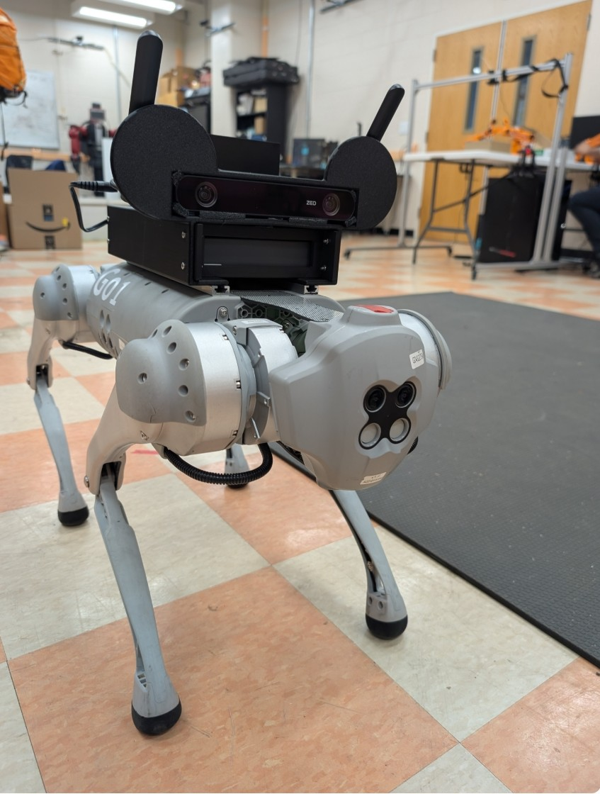
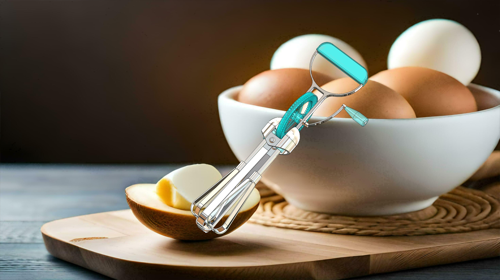

<h1>Camden Norris</h1>

Automotive Engineering • Robotics • Mechanical Design

I am an Automotive Engineering student at Clemson University with an Engineering Leadership minor. My interests include robotics, automotive systems, mechanical design, computer vision, and intelligent machines.

My work includes quadruped robotics research, Clemson Formula SAE Powertrain, mechanical CAD and simulation, gesture-controlled robotics, and dashboard development.

<a class="portfolio-button primary" href="/projects/">View Projects</a>
<a class="portfolio-button" href="/resume/">Resume</a>
<a class="portfolio-button" href="https://github.com/CamdenNorris" target="_blank">GitHub</a>

<h2>Featured Projects</h2>

<h3>GO1 Quadruped Robotics</h3>

Python • Computer Vision • Gesture Recognition • Dashboard Development

Developing a gesture-controlled quadruped robotics system using computer vision and hand tracking, along with a dashboard for monitoring robot status, recognized gestures, system feedback, and control functions.

<a class="portfolio-button primary" href="/projects/#go1-quadruped-robotics">View Project</a>

<h3>Mechanical Hand Mixer</h3>

SolidWorks • CAD • Simulation • Mechanical Design

Designed and assembled a multi-component mechanical hand mixer in SolidWorks, including custom components, engineering drawings, material selection, mechanical motion, and structural analysis.

<a class="portfolio-button primary" href="/projects/#mechanical-hand-mixer">View Project</a>

<h3>Clemson Formula SAE</h3>

Automotive Engineering • Powertrain • Mechanical Design

Member of Clemson Formula SAE's Powertrain Division, applying automotive engineering principles while gaining hands-on experience with powertrain systems, mechanical design, vehicle development, and collaborative engineering.

<a class="portfolio-button primary" href="/projects/#clemson-formula-sae">View Project</a>

<h2>Technical Skills</h2>

SolidWorks
Python
Computer Vision
Gesture Recognition
Dashboard Development
Git
GitHub
Mechanical Design
CAD
Simulation
Automotive Engineering

<h2>Current Focus</h2>

I am continuing to develop experience across automotive engineering, robotics, mechanical design, computer vision, and intelligent systems. My current work includes improving gesture-based robot control, developing a monitoring dashboard for the robotics system, and contributing to Clemson Formula SAE.

<a class="portfolio-button primary" href="/projects/">Explore My Work</a>
<a class="portfolio-button" href="/experience/">Experience</a>
<a class="portfolio-button" href="/contact/">Contact</a>

