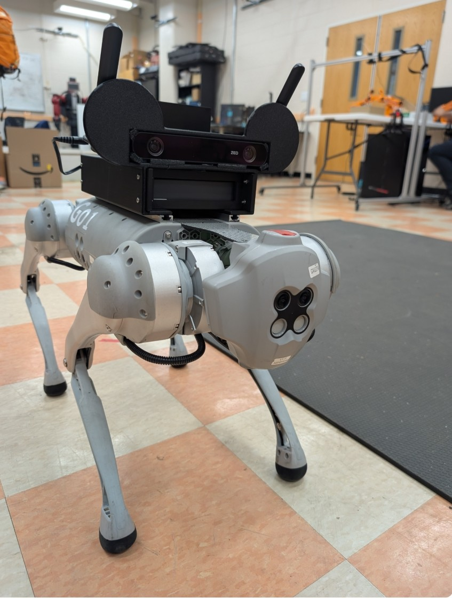
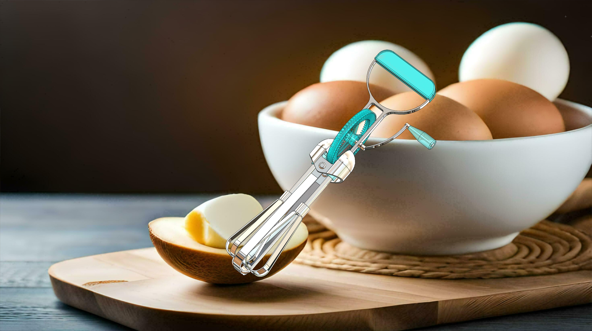
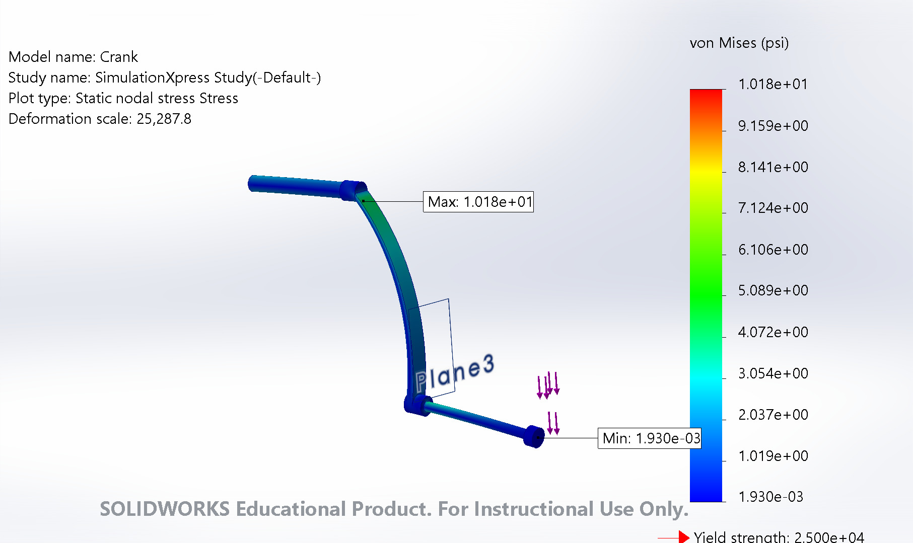
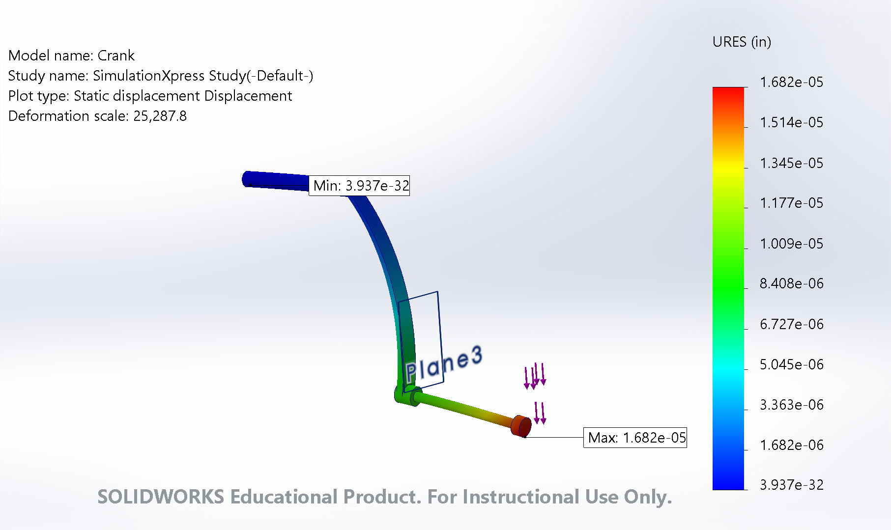

This page highlights selected work in robotics, automotive engineering, mechanical design, CAD, simulation, and computer vision.

<h2>GO1 Quadruped Robotics</h2>

Python • Computer Vision • Hand Tracking • Gesture Recognition • Dashboard Development • Git/GitHub

<h3>Overview</h3>

I am working on a quadruped robotics project focused on developing an intuitive way to interact with and control the robot using computer vision and hand gestures.

The system uses real-time hand tracking and gesture recognition to translate intentional hand movements into robot commands. The project has progressed from early simulation and perception testing toward a gesture-focused control system with real-time system feedback.

<h3>Current Development</h3>

<ul>
<li>Real-time webcam-based hand detection and tracking</li>
<li>Gesture-based robot movement commands</li>
<li>Gesture-based speed control</li>
<li>Improving recognition between similar hand gestures</li>
<li>Reducing unintended or incorrect gesture classifications</li>
<li>Using hand gestures as the primary user control input</li>
<li>Connecting validated gestures to robot control functions</li>
<li>Testing recognition across different hand positions and environments</li>
<li>Developing a dashboard for robot monitoring and system feedback</li>
<li>Using Git and GitHub for collaborative development and version control</li>
</ul>

<h3>Dashboard Development</h3>

I am developing a dashboard to serve as a centralized interface for the robotics system. The dashboard makes it easier to monitor what the perception system is detecting and how the robot is responding in real time.

The dashboard is being developed to display information such as robot status, recognized gestures, system feedback, and relevant control functions. This provides a visual connection between the perception system and robot behavior while also making testing and troubleshooting easier.

<h3>Project Goal</h3>

The goal is to create a reliable and intuitive human-robot interaction system where hand gestures can control the robot without relying on traditional keyboard controls, while the dashboard provides clear feedback about system behavior.

<h3>Demo</h3>

<video class="project-video" controls preload="metadata">
<source src="/assets/files/go1/go1-demo-web.mp4" type="video/mp4">
Your browser does not support embedded video.
</video>

<h3>Technical Focus</h3>

Python
Computer Vision
Hand Tracking
Gesture Recognition
Dashboard Development
Robot Control
Git
GitHub

<h2>Mechanical Hand Mixer Design</h2>

SolidWorks • CAD • Mechanical Design • Simulation

<h3>Overview</h3>

Designed and assembled a multi-component mechanical hand mixer in SolidWorks. The project combined individual component modeling, mechanical assembly design, engineering drawings, material selection, motion, and structural analysis.

<h3>Project Highlights</h3>

<ul>
<li>Modeled individual mechanical components in SolidWorks</li>
<li>Created the complete mechanical assembly</li>
<li>Developed the crank and gear mechanism</li>
<li>Produced dimensioned engineering drawings</li>
<li>Selected materials for individual components</li>
<li>Evaluated von Mises stress</li>
<li>Evaluated displacement</li>
<li>Created a mechanical motion demonstration</li>
</ul>

<h3>Assembly Demo</h3>

<video class="project-video" controls preload="metadata">
<source src="/assets/files/hand-mixer/complete-assembly.mp4" type="video/mp4">
Your browser does not support embedded video.
</video>

<h3>Engineering Analysis</h3>

<strong>Von Mises Stress Analysis</strong>

<strong>Displacement Analysis</strong>

<h3>Technical Drawings</h3>

<a class="portfolio-button primary"
href="/assets/files/hand-mixer/complete-assembly.pdf"
target="_blank">
Assembly Drawing
</a>

<a class="portfolio-button"
href="/assets/files/hand-mixer/beater-base.pdf"
target="_blank">
Beater Base Drawing
</a>

<a class="portfolio-button"
href="/assets/files/hand-mixer/crank.pdf"
target="_blank">
Crank Drawing
</a>

<h2>Clemson Formula SAE</h2>

Automotive Engineering • Powertrain • Mechanical Design • Vehicle Development

<h3>Overview</h3>

I am a member of Clemson Formula SAE's Powertrain Division, where I have the opportunity to apply automotive engineering concepts to the development of a competition vehicle.

The experience provides hands-on exposure to the engineering design process while working within a multidisciplinary student team.

<h3>Areas of Experience</h3>

<ul>
<li>Automotive powertrain systems</li>
<li>Mechanical design</li>
<li>Vehicle development</li>
<li>Engineering collaboration</li>
<li>Design evaluation</li>
<li>Team-based problem solving</li>
<li>Applying classroom engineering concepts to a real vehicle platform</li>
</ul>

<h3>Technical Focus</h3>

Automotive Engineering
Powertrain
Mechanical Design
Vehicle Development
Engineering Collaboration

